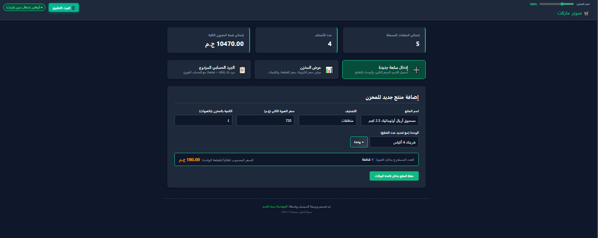
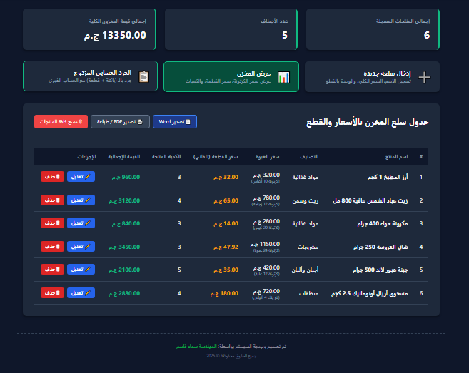
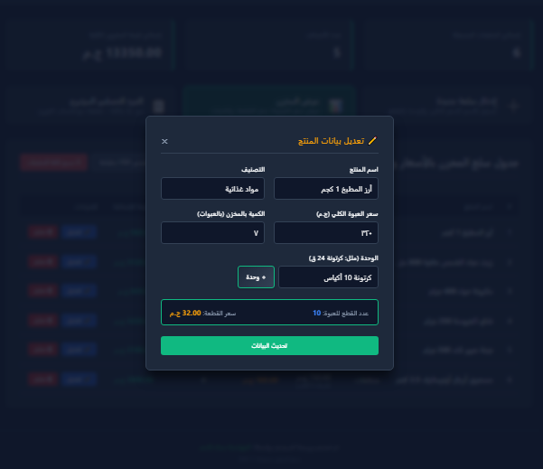
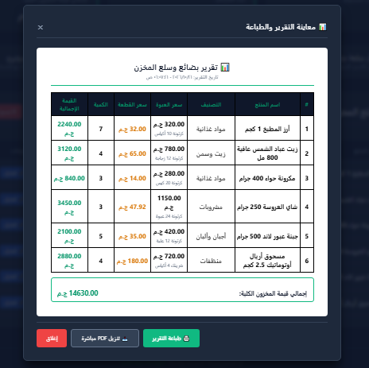
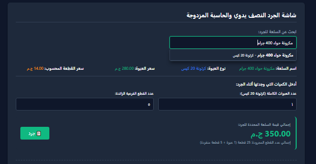
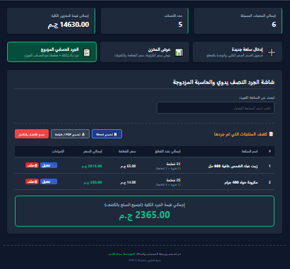
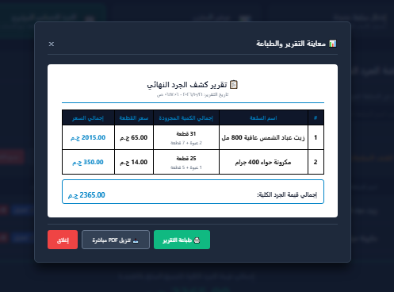
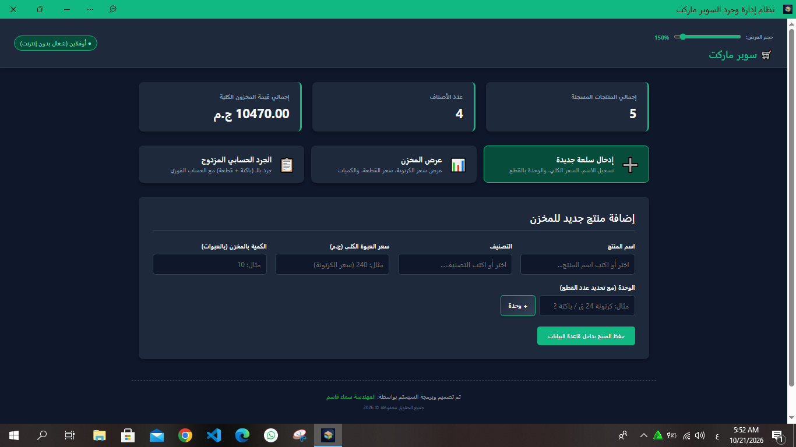
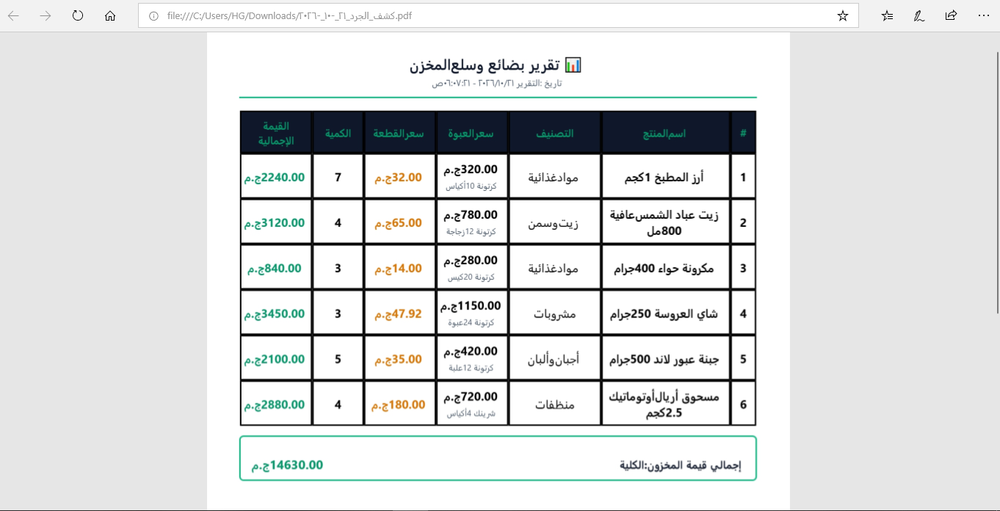

# 🛒 Supermarket Management & Inventory System (PWA)

An end-to-end, lightweight Progressive Web Application (PWA) designed for modern retail and supermarket inventory tracking. Built for high performance and offline capability, utilizing Client-Side IndexedDB storage for seamless operations without backend overhead.

---

## 🌟 Key Features

- **📦 Inventory Management:** Add, update, and manage products with exact quantities, categories, and unit conversions.
- **⚡ Client-Side Persistence (IndexedDB):** Fast, reliable, offline-first local data storage using browser IndexedDB.
- **📊 Report Generation:** Export stock state, invoices, and transaction summaries directly to **PDF** and **Word (.docx)** documents.
- **📱 PWA & Offline Support:** Installable on Desktop & Mobile platforms (iOS/Android) via Web App Manifest & Service Workers.
- **🎯 Unit Conversion System:** Dynamic calculations for bulk/piece conversions to eliminate stock discrepancy.
- **🎨 Responsive UI:** Clean, custom-tailored interface designed for fast UI interactions and ease of use in fast-paced retail settings.

---

## 🛠 Tech Stack

- **Frontend:** HTML5, CSS3 (Modern Responsive Layouts), JavaScript (ES6+)
- **Storage Layer:** Browser IndexedDB (No-SQL Client-Side Engine)
- **Document Generators:** PDF & Word Generation Libraries
- **PWA Tooling:** PWABuilder Manifest & Service Workers
- **Hosting & CI/CD:** Vercel

---

## 🚀 Live Demo & Installation

- **Live Application:** [View Live Demo on Vercel](#) *https://supermarket-mobile-app.vercel.app*
- **Installation:** Open the live link on any Chrome/Safari/Edge browser and click **"Install App"** to use it offline on Desktop or Mobile.

---

## 📸 Full System Screenshots & Workflow

معرض الشاشات الكامل للنظام (11 صورة توضح كل واجهات ووظائف السيستم بالكامل):

| شاشة أمان وتفعيل الترخيص | إضافة سلعة جديدة للمخزن |
| :---: | :---: |
|  |  |

| لوحة عرض المخزن والسلع | تعديل بيانات السلعة والوحدات |
| :---: | :---: |
|  |  |

| إشعار حفظ/تعديل البيانات | معاينة وتصدير تقرير السلع (PDF) |
| :---: | :---: |
|  |  |

| واجهة الجرد الحسابي المزدوج | كشف المنتجات المجرودة وتفاصيلها |
| :---: | :---: |
|  |  |

| معاينة وتصدير كشف الجرد النهائي | التطبيق مثبت ويعمل كـ PWA Standalone |
| :---: | :---: |
|  |  |

| مستند التقرير النهائي المُصدّر (PDF) |
| :---: |
|  |
---

## 👩‍💻 Developed By

**Eng. Samaa Kasem**  
*Software Engineer & Web Developer*  
- **GitHub:** [@samaakasem](#) *https://github.com/samaakasem82*

*© 2026 Eng. Samaa Kasem. All rights reserved.*